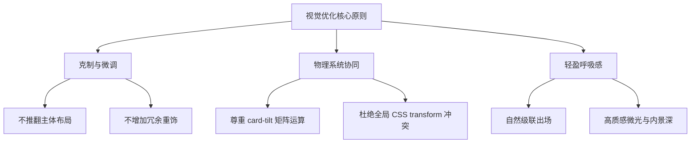
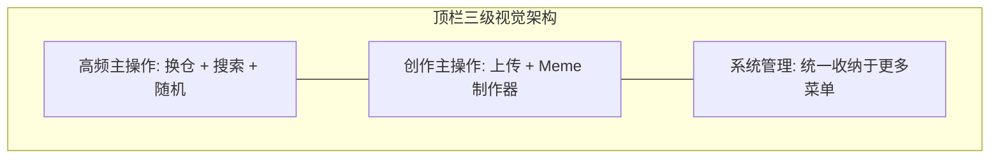
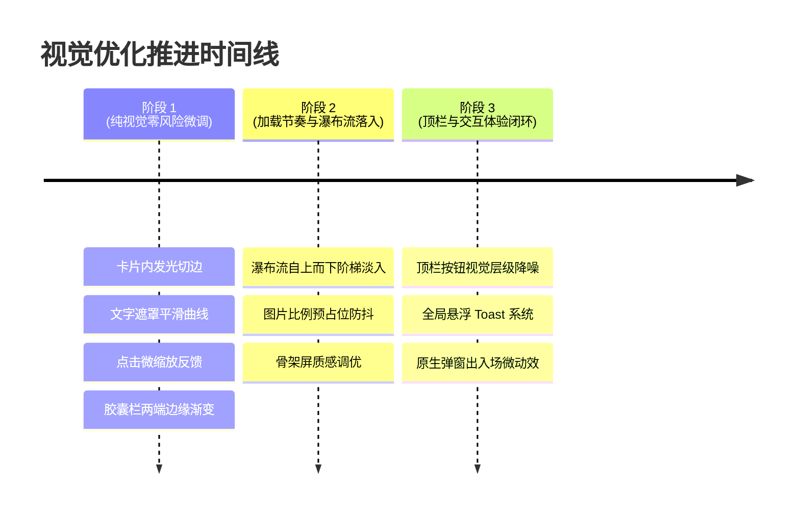

# Meme Vault 视觉设计与交互体验优化提案

> **版本**：v1.0\
> **定位**：在保持原版深色调、自适应瀑布流与核心交互基线稳定的前提下，针对“呼吸感、轻盈感、动效节奏与材质层次”提出的微调与进阶优化方案。\
> **基线**：以 v2.0.4 稳定版架构为基础，完全兼容 `card-tilt.ts` 物理引擎与多仓（Multi-Vault）外观系统。

---

## 一、 核心设计原则与定位

Meme Vault 的核心价值在于**快速查找、沉浸浏览与顺畅创作**。界面应当充当“低调、精致的背景”，让形形色色的 Meme 与二次元图片成为绝对的视觉主角。



1. **克制微调，保留主体**：用户的核心满意点在于原版的沉浸黑底、双行胶囊过滤条、高效的自适应瀑布流以及右侧详情工作台。优化方向是**锦上添花**（质感提升、平滑过渡、动效协同），绝不全盘重做。
2. **物理动力学兼容**：现有的 `card-tilt.ts`（3D 倾斜、重心跟随、宽高比阻尼）和 `drunk-physics.ts`（醉酒物理震颤）是项目的亮点系统。所有悬停动效必须与该系统的内联 CSS 变量深度协同，禁止使用冲突的全局 `animation` 或覆盖 `transform`。
3. **轻盈与克制（Subtle & Predictable）**：动效持续时间控制在 150ms ~ 300ms 之间，严禁拖沓；利用缓动贝塞尔曲线实现“如丝般顺滑”的自然起伏，杜绝机械式线性变化。

---

## 二、 现有视觉痛点与教训复盘

| 痛点场景 | 现状表现 | 根因剖析 | 改进思路 |
| :--- | :--- | :--- | :--- |
| **卡片悬停突兀感** | 光标放卡片上时先启动物理倾斜，之后文字保护层突然瞬间闪现。 | 文字保护层（防眩晕暗色渐变遮罩）在动画结束后才突然触发或透明度阶跃过快。 | 将遮罩的 `opacity` 与物理悬停缓动统一绑定，使用平滑贝塞尔曲线协同淡入。 |
| **瀑布流加载节奏** | 换页或加载更多时，卡片呈现生硬的“从左到右横向刷出”或瞬间硬切。 | 缺乏卡片级联渐入（Staggered Entrance）机制，整个网格重排过程直接暴露在用户眼前。 | 引入毫秒级瀑布级联淡入，配合图片解码占位，实现自上而下的自然落入感。 |
| **界面略显僵硬** | 界面静止时略感板正，控件与卡片多用单层 1px 灰色边框硬切，缺少纵深。 | 仅依靠平面的色阶差，缺乏层次化的环境光晕（Ambient Glow）与内发光（Inner Rim Light）。 | 增加精细的微弱内发光与柔和漫反射投影，营造悬浮感。 |
| **顶栏信息密度过大** | 顶栏横向堆叠了十余个操作按钮，重心分散，缺乏主次对比。 | 浏览操作（高频）与系统管理操作（低频）平级排列，视觉未做分级减负。 | 实施“三级视觉降噪”：高频高亮、次频次级、低频收纳于精致的折叠上下文。 |
| **双行筛选栏横划引导** | 模板与标签横向滚动列表在边缘直接被切断，不易察觉右侧还有内容。 | 列表容器两端缺少渐进式微光遮罩（Scroll Mask Fade）。 | 增加左右两端自适应的 CSS `mask-image` 边缘渐弱过渡。 |

---

## 三、 5大维度微调与优化提案

### 维度 1：微质感与光影呼吸（Materiality & Ambient Light）

不移动任何实体节点，仅通过微弱光影给予界面“有机生命感”：

1. **悬浮卡片微内发光（Inner Rim Light）**：
   - 当前卡片依靠单调的 `border: 1px solid var(--border)`。
   - **优化**：在卡片顶部增加 `box-shadow: inset 0 1px 0 rgba(255, 255, 255, 0.08)`，模拟顶部冷光源掠过的精致高光切边，令深色卡片脱离死板。
2. **极微弱的背景环境光感（Ambient Drift）**：
   - 在底板后方维持一个极其低饱和度、超慢周期（15s~20s 往复）的径向微光晕，透明度不超过 3%~5%。
   - 用户几乎无法刻意感知到它在移动，但整体界面会彻底摆脱“一块死黑铁板”的压抑感。
3. **磨砂玻璃质感升级（Backdrop Polish）**：
   - 顶栏与详情抽屉的 `backdrop-filter: blur(16px)` 配合 `saturate(180%)`，使穿透的图片与背景色彩更鲜活饱满，而不泛白灰。

---

### 维度 2：卡片悬停与物理引擎深度协同（Card Hover Harmony）

彻底解决此前导致“卡片乱跳、文字突兀闪现”的问题：

```text
光标移入卡片 (PointerEnter)
   │
   ├─► card-tilt.ts: 启动 rAF 矩阵计算 (TranslateX/Y, RotateX/Y, Scale)
   │
   └─► CSS: 遮罩与光晕协同淡入 (cubic-bezier(0.16, 1, 0.3, 1), 220ms)
         ├─ 文字保护渐变阴影平滑 Cross-fade (0 -> 1)
         └─ 边缘漫反射发光柔和漫开 (0 -> 1)
```

1. **文字保护遮罩（Crisp Text Protection）平滑渐显**：
   - 遮罩采用 `linear-gradient(to top, rgba(0,0,0,0.85) 0%, rgba(0,0,0,0.4) 60%, transparent 100%)`。
   - 设定独立 `transition: opacity 220ms cubic-bezier(0.16, 1, 0.3, 1)`，光标进入瞬间随物理倾斜同时轻柔浮现，绝不再等动画结束后硬切。
2. **自适应外发光微晕（Diffused Hover Glow）**：
   - 悬停时光晕不使用突兀的高亮白光，而是提取主题强调色（Accent Color）以 12% 不透明度向外漫反射扩散（`box-shadow: 0 12px 32px -8px var(--accent-glow)`）。
3. **物理点击态触感（Active Press Micro-feedback）**：
   - 当点击某张卡片时，加入短暂的瞬态下压感（80ms 内 `scale(0.985)`），随后弹出详情，赋予用户如同真实实体卡牌的按压反馈。

---

### 维度 3：瀑布流与加载节奏优化（Waterfall Loading Rhythm）

解决“加载从左到右硬刷”与布局跳动问题：

1. **错峰渐入（Staggered Entrance）**：
   - 新卡片渲染或换页时，为前 12 张卡片自动挂载递增延迟：
     ```css
     .meme-card:nth-child(n) {
       animation: card-cascade-in 300ms cubic-bezier(0.16, 1, 0.3, 1) both;
       animation-delay: calc(min(var(--card-index, 0), 12) * 25ms);
     }
     ```
   - 效果：卡片像多米诺骨牌或水滴入泉一样自上而下顺滑落入，彻底终结瞬间左向硬刷。
2. **预占位比例与防跳动（Layout Shift Prevention）**：
   - 确保卡片骨架容器通过 `aspect-ratio: attr(data-aspect-ratio)` 在图片尚未完全解码前就撑开准确位置，滚动浏览时不再出现图片加载后的突跳抖动。

---

### 维度 4：顶栏与操作流层次重构（Visual Hierarchy）

为密集的操作栏打造清晰的“呼吸节奏”：



1. **视觉分级降噪**：
   - **核心浏览流（高频）**：Vault 切换器与智能搜索框占据视觉中心，具备明显的外框与轻聚焦光晕。
   - **创作行动（次高频）**：“上传 Meme”与“制作器”采用品牌次级强调色按钮。
   - **维护与配置（低频）**：巡检、元数据整理、API 设置等统一归入带有小圆点状态灯的下拉菜单中，顶栏呼吸空间立即提升 40%。
2. **横向筛选胶囊栏边缘微光遮罩（Scroll Mask Fade）**：
   - 为模板行与标签行增加左右边缘的渐隐遮罩：
     ```css
     mask-image: linear-gradient(to right, transparent, black 24px, black calc(100% - 24px), transparent);
     ```
   - 左右两边自然淡出，用户无需滚动即可直观意识到“两侧可横向探索”。

---

### 维度 5：微交互与反馈轻量化（Micro-interactions & Polish）

1. **全局浮动胶囊提示（Floating Capsule Toast）**：
   - 彻底取代在按钮上临时切换文字（如“已复制！”）或控制台报错的旧模式。
   - 触发“复制成功/已加入收藏/保存草稿”时，屏幕底部正中轻快弹出一枚带有微高斯模糊的深色小胶囊，1.8 秒后平滑浮上并隐去。
2. **原生弹窗平滑进出（Modern Modal Transitions）**：
   - 针对详情面板、制作器与设置弹窗，配置现代 CSS `@starting-style`：
     - 打开时：从 `scale(0.96) translateY(8px)` 顺滑升至 `scale(1) translateY(0)`，配合 backdrop 模糊渐入。
     - 关闭时：快速利落地淡出（150ms），确保动作不拖泥带水。
3. **AI 思考流光动效（AI Scanning Shimmer）**：
   - 当点击“AI 识别”或“生成文案”时，在目标区域呈现一道优雅掠过的细光栅扫描动效（Shimmer），给用户明确的“算法正在分析图片特征”的科技质感与耐心预期。

---

## 四、 分阶段实施建议路线图

为确保每一步都经过充分测试且绝不引起稳定版回退，建议分三阶段推进：



### 阶段 1：纯视觉与微质感提升（零风险、不改 DOM）
- **范围**：纯 CSS Tokens 与样式微调。
- **改动点**：
  1. 卡片内高光边框（Inner Rim Light）；
  2. 文字防眩晕遮罩的进入曲线平滑化，与物理倾斜同步；
  3. 按钮与卡片的 `:active` 实体按压触感；
  4. 筛选胶囊栏的边缘滚动遮罩（Mask Fade）。
- **风险**：0。不需要修改任何 TypeScript 逻辑或组件生命周期。

### 阶段 2：加载节奏与瀑布流落入（改善流畅度）
- **范围**：优化网格渲染时的出场序列。
- **改动点**：
  1. 卡片挂载 `animation-delay` 阶梯级联落入效果；
  2. 优化图片加载占位与解码后的 Cross-fade 平滑替换。
- **风险**：低。需验证快速连续翻页和无限滚动时的动画性能。

### 阶段 3：操作栏层级与交互闭环（系统级舒适度）
- **范围**：顶栏微重组与全局反馈组件。
- **改动点**：
  1. 顶栏按钮主次分级；
  2. 接入轻量悬浮胶囊 Toast；
  3. 原生 `<dialog>` 进出场动效。
- **风险**：极低。有现成的测试套件作为守护屏障。

---

## 五、 必须坚守的工程红线

1. **绝对禁止在 `.meme-card` 上覆盖全局 `transform` 或添加死循环 CSS `animation`**：
   - 所有的位移和倾斜必须交由 `card-tilt.ts` 的 `requestAnimationFrame` 驱动。
   - CSS 只负责处理 `opacity`、`box-shadow`、`filter` 与内发光等无害渲染属性。
2. **样式严格按模块组织，不污染全局**：
   - 新增微质感规则必须放入对应的 [tokens.css](../../frontend/src/styles/tokens.css)、[library.css](../../frontend/src/styles/library.css) 或 [shell.css](../../frontend/src/styles/shell.css)，禁止在单一大文件里强行使用 `!important` 打补丁。
3. **保持 60/120 FPS 渲染基准**：
   - 任何动效属性严格限制在 `transform` 和 `opacity`（合流图层），杜绝引发大面积 DOM 重排（Reflow）的属性（如在动效中动态修改 `width` / `height` / `margin`）。
4. **尊重低动效偏好（Prefers-Reduced-Motion）**：
   - 当系统开启“减弱动态效果”时，所有阶梯级联与微光律动立即平滑降级为静态展示。
