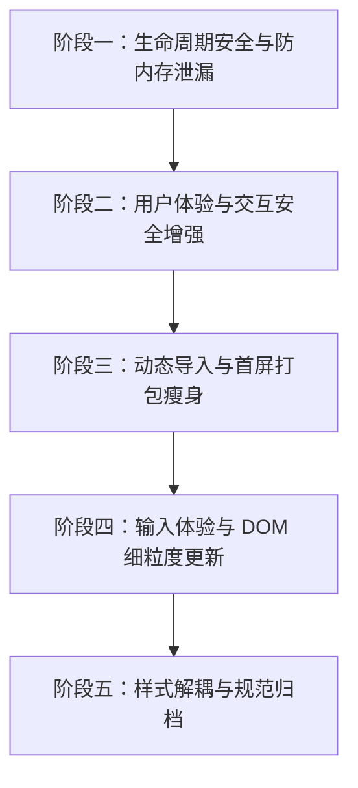

# MemeVault 前端架构治理与体验优化任务书

> 版本标识：`v2.0.4` 前端专项  
> 适用范围：`frontend/` 目录所有 TypeScript、样式与前端测试代码  
> 基线状态：已通过全部 40 个测试套件 / 379 项 Vitest 测试；生产构建首屏 JS 406 KB，CSS 102 KB  

---

## 1. 任务背景与核心目标

### 1.1 背景
Meme Vault 在完成 v2.0 多仓库（Multi-Vault）、Profile 专属元数据、每仓外观和资产序号后，前端功能已高度完备。但随着系统复杂度提升，前端代码逐渐累积了如下结构性技术债：
1. **首屏单体体积过大**：全量重型弹窗（Meme Forge 制作器、AI 审核工作台、宝库巡检、API 设置、批量导入导出）全部打包至首屏入口（406 KB），访客角色也会下载全部管理代码。
2. **全局事件监听器缺乏销毁契约**：`MemeVaultApp` 在会话注销、登录切换时未解除全局监听，易造成内存泄漏与多次触发。
3. **动画与定时器游离**：画廊翻页时直接整块重写 `innerHTML`，未清理旧卡片上正在运行的缓动动画帧（rAF）与归位定时器。
4. **交互体验与防丢机制不完善**：快捷操作缺乏统一轻量 Toast 反馈；主详情编辑表单与 Anime 作品信息表单缺少未保存切换拦截；语义搜索缺少显式回车提交提示。
5. **词汇表有残余硬编码**：加载中提示、沉浸流尾部等偶现硬编码“Meme”，影响非 Meme 仓体验。
6. **样式巨石化**：`main.css` 超过 3,500 行，多模块样式混杂。

### 1.2 核心目标
- **0 破坏性变化**：保持所有现有功能、API 协议与视觉风格 100% 兼容。
- **首屏瘦身**：引入 Dynamic Import，将低频弹窗改为按需加载，首屏 JS 显著精简。
- **生命周期严密**：建立 `destroy()` 契约，彻底杜绝全局监听与动画定时器泄漏。
- **交互稳健**：补齐统一轻量 Toast、编辑防丢拦截与语义搜索指引。
- **模块清晰**：拆分巨石样式文件与优化输入框 DOM 抖动。

---

## 2. 分阶段实施路线规划



---

### 阶段一：生命周期安全与防内存泄漏（P1）

#### 1. 目标
解决 `MemeVaultApp` 与卡片动画缺少清理机制的问题，消除潜在的事件多重绑定与后台幽灵 rAF 调度。

#### 2. 涉及文件
- `frontend/src/app.ts`
- `frontend/src/main.ts`
- `frontend/src/card-tilt.ts`
- `frontend/src/drunk-physics.ts`
- `frontend/src/app.test.ts`
- `frontend/src/card-tilt.test.ts`

#### 3. 详细方案
1. **主应用生命周期管理**：
   - 在 `MemeVaultApp` 内部引入 `private readonly abortController = new AbortController()`。
   - 所有绑定在 `window`（如 `popstate`）和 `document`（如快捷键 `keydown`）的事件均传入 `{ signal: this.abortController.signal }`。
   - 实现 `destroy(): void` 方法：
     - 调用 `this.abortController.abort()` 注销所有全局事件。
     - 递归调用已有子控制器的清理接口：`this.appShell.destroy()`、`this.immersiveFeed.destroy()`、`this.captionLab.destroy()`、`this.drunkPhysics.stop()`。
   - 在 `main.ts` 中维护当前 `currentApplication: MemeVaultApp | null`，在 `showGate` 或二次 `startVault` 前显式调用 `currentApplication?.destroy()`。
2. **卡片动态效果的防幽灵调度**：
   - 在 `card-tilt.ts` 导出 `unbindMemeCardTilts(container: ParentNode): void`。
   - 遍历容器内所有 `.meme-card[data-meme-id]`，主动触发 `boundCards.get(card)?.()`，取消挂起的 `requestAnimationFrame` 和 `returnTimer`。
   - 在 `ui.ts` 的 `renderLibrary` 每次清空或覆盖 `memeGrid.innerHTML` 之前，先调用 `unbindMemeCardTilts(elements.memeGrid)`。

#### 4. 验证方法
- 编写专项单测：模拟多次 `login -> logout -> login`，断言全局监听器数量不递增。
- 翻页与重新渲染卡片时，断言旧卡片的 rAF / timeout 被成功取消。

---

### 阶段二：用户体验与交互安全增强（P1）

#### 1. 目标
补齐轻量反馈机制、详情编辑防丢拦截、语义搜索引导与词汇表无死角去 Meme 化。

#### 2. 涉及文件
- `frontend/src/ui.ts`
- `frontend/src/app.ts`
- `frontend/src/toast.ts`（新增微模块）
- `frontend/src/mobile-ingest.ts`
- `frontend/src/vault-profile.ts`
- `frontend/src/vault-profile.test.ts`

#### 3. 详细方案
1. **轻量 Toast 系统**：
   - 新增独立的原生 `ToastController`，挂载在 `#app` 浮层中，支持 `show(message, type = "info" | "success" | "error")`。
   - 自动排队、淡入、停留 2 秒、淡出移除，支持手动点击关闭。
   - 接入现有动作：单图复制成功、牌组更新成功、弱关联变更、作品信息保存成功。
2. **详情编辑防丢拦截（Dirty Guard）**：
   - 当详情面板处于“编辑 Meme”状态（标题/描述/标签有变更未保存）或“编辑作品信息”状态时：
     - 用户点击左侧画廊其他卡片、切换页码、点击随机按钮或切换仓库时，弹出确认提示：“当前修改尚未保存，确认离开吗？”。
     - 用户选择“取消”则阻断跳转，保留编辑态；选择“放弃”则清理草稿并正常切换。
3. **语义搜索显式提交提示**：
   - 当 `searchMode === "semantic"` 时，在搜索框尾部渲染醒目的提示芯片（如 `↵ 回车检索`），或在输入字符且未提交时，高亮提交按钮，消除用户“为何不自动筛选”的困惑。
4. **词汇表（Vocabulary）细节彻底覆盖**：
   - 替换 `ui.ts` 中写死的文案：
     - 列表加载中：`正在加载 ${vocabulary.assetPlural}…`。
     - 沉浸模式尾部：`这里暂时没有 ${vocabulary.assetPlural}。` / `已经翻到 ${vocabulary.assetSingular} Vault 最深处了。`。
     - 沉浸搜索框与顶栏搜索框 placeholder：根据当前 Profile 动态显示。
5. **Mobile Ingest 错误提示修正**：
   - 将 413 错误文案更新为：“文件超过仓库单图大小限制”。

#### 4. 验证方法
- 交互测试：验证表单修改后点击其他卡片触发确认阻断；放弃后正常切换。
- 词汇测试：扩充 `vault-profile.test.ts`，验证 anime / photo 仓库下无遗留 "Meme" 字符。

---

### 阶段三：动态导入与首屏打包瘦身（P2）

#### 1. 目标
将低频使用的重型创作、分析、管理弹窗改为动态按需加载，首屏 JS 显著瘦身。

#### 2. 涉及文件
- `frontend/src/app.ts`
- `frontend/src/app-shell.ts`
- `frontend/vite.config.ts`

#### 3. 详细方案
1. **动态加载改造列表**：
   - `MemeMakerController`（约 109 KB 代码）
   - `EnrichmentWorkbenchController`（约 26 KB 代码）
   - `VaultInspectorController`（约 16 KB 代码）
   - `AISettingsController`（约 25 KB 代码）
   - `BatchUploadController`（约 32 KB 代码）
   - `BatchDownloadController`（约 13 KB 代码）
2. **加载策略**：
   - 在 `MemeVaultApp` 中，将上述控制器改造为惰性加载代理（Lazy Controller）：
     ```typescript
     private memeMakerPromise: Promise<MemeMakerController> | null = null;
     private async getMemeMaker(): Promise<MemeMakerController> {
       if (!this.memeMakerPromise) {
         this.memeMakerPromise = import("./meme-maker").then(
           ({ MemeMakerController }) => new MemeMakerController(...)
         );
       }
       return this.memeMakerPromise;
     }
     ```
   - 点击顶部或菜单入口时，如果模块尚未加载，对应按钮进入短暂 loading 态，加载完成后打开对话框。
   - 访客身份（Visitor）天然不触碰管理入口，完全不会请求这部分 JS。

#### 4. 验证方法
- 运行 `npm run build`，对比打包 chunks，主包 `main.js` 从 406 KB 降至 200 KB 以内。
- 自动化测试：通过 mock dynamic import 验证各弹窗点击后正确加载并打开。

---

### 阶段四：输入体验与 DOM 细粒度更新（P2）

#### 1. 目标
消除 `TagEditor` 击键时的全树重刷，提升中文输入法（IME）流畅度。

#### 2. 涉及文件
- `frontend/src/tag-editor.ts`
- `frontend/src/tag-editor.test.ts`

#### 3. 详细方案
- 分离输入框 DOM 与下拉联想列表 DOM：
  - `<input>` 元素仅在进入编辑态时创建一次。
  - 用户在输入框中打字时，只根据输入值过滤并局部重绘 `.tag-editor-suggestions` 下拉项，绝不销毁重建 `<input>`。
  - 彻底规避 `queueMicrotask(() => input.focus())` 导致的焦点跳跃和光标位置被重置的问题。

#### 4. 验证方法
- 运行现有 `tag-editor.test.ts` 确保全部通过。
- 增加中文合成事件（`compositionstart` / `compositionend`）与光标连续输入测试。

---

### 阶段五：样式解耦与规范归档（P3）

#### 1. 目标
拆解 3,500 行的 `main.css` 巨石文件，按功能组件就近组织样式。

#### 2. 涉及文件
- `frontend/src/styles/main.css`
- 新增独立样式文件：
  - `frontend/src/styles/meme-maker.css`
  - `frontend/src/styles/tag-manager.css`
  - `frontend/src/styles/settings.css`
  - `frontend/src/styles/enrichment.css`
  - `frontend/src/styles/vault-inspector.css`
  - `frontend/src/styles/batch.css`
  - `frontend/src/styles/toast.css`

#### 3. 详细方案
- 将对应选择器精准迁移至独立样式文件，并在 `main.ts` 中结构化引入。
- 保持所有 CSS Variables、Tokens 与类名完全一致，做严格的 0 样式回归校验。

#### 4. 验证方法
- 运行 `npm run build` 确保样式打包正常。
- 运行 `git diff --check` 与前端所有测试，确保样式选择器未丢失。

---

## 3. 明确不处理的内容（Boundary）

为了遵守项目的最小影响与职责分离原则，本次前端优化**明确不包含**以下内容：
1. **不引入外部前端框架**：严格保留原生 TypeScript + 原生 DOM，不引入 React、Vue、Svelte、Tailwind 或大型 UI 库。
2. **不修改后端 API 协议**：不改动后端现有的 URL、请求结构、响应结构与状态码。
3. **不变更数据库与迁移**：不修改 ORM 模型、SQLite 表结构或本地图片存储。
4. **不变更既有算法逻辑**：不修改语义向量检索、Free Gallery 占位物理计算（Occupancy Grid）、Card Tilt 计算模型。

---

## 4. 验收标准与交付物

1. **测试验收**：
   - `npm.cmd --prefix frontend run typecheck` 零错误通过。
   - `npm.cmd --prefix frontend test` 全部通过（测试数在现有 379 项基础上只增不减）。
   - `npm.cmd --prefix frontend run build` 构建成功且主 bundle 体积明显缩减。
2. **文档同步**：
   - 更新 `docs/CODEBASE_STATUS.md`。
   - 更新 `docs/PROJECT_PLAN.md`。
