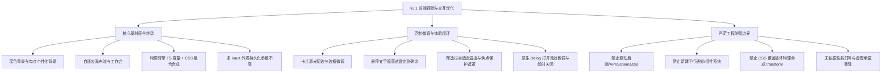
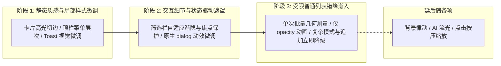

# Meme Vault v2.1 前端视觉与交互优化任务书

> **版本**：v2.1\
> **制定时间**：2026-10-18\
> **任务性质**：工程规划与实施任务书（本轮仅规划，禁止修改任何代码与执行开发）\
> **当前状态**：**规划阶段未执行**（所有源码路径与行号均为静态节选核验，运行时视觉现象待确诊，基线保持冻结）\
> **协同分工**：Gemini 负责规划与后续具体实现；Codex 负责独立比对验收；协调者将本文机械保存至 `docs/planning/v2.1_前端视觉与交互优化任务书.md`。

---

## 一、 版本定位、核心目标与严格工程边界

### 1.1 核心目标
在完全保持 Meme Vault 原版深色调、自适应多列瀑布流、右侧详情工作台、`card-tilt.ts` / `drunk-physics.ts` 物理引擎驱动以及多仓（Multi-Vault）外观系统与全部持久化参数兼容的前提下，针对原视觉提案提出的“轻盈呼吸感、材质微质感、悬停协同与滚动交互节奏”进行克制、分阶段的微调与体验闭环。



### 1.2 明确非目标（Non-Goals）
1. **不修改后端与数据协议**：不新增、修改或调整任何 FastAPI 路由、Service、Repository、Model、Pydantic Schema、SQLite 表结构与迁移脚本。若实施中遇到任何后端改动诉求，**立即停止并向用户报告**，不绕过边界。
2. **不新增或覆盖后端外观持久化字段**：多 Vault 背景允许用户上传背景图片或配置专属外观参数（包括模糊、饱和度等）。本期微调纯属前端 CSS 层局部渲染优化，严禁硬性覆盖用户已持久化的背景与毛玻璃设置，不新增任何后端外观字段。
3. **不重构或重写物理引擎**：不得重写 `card-tilt.ts` 与 `drunk-physics.ts` 的动画帧调度与数学模型；CSS 仅参与变量合成，不破坏已有的物理级联。
4. **不引入新依赖与大型框架**：严禁引入 React、Vue、Tailwind、Framer Motion 或其他三方库，严格基于原生 TypeScript + 模块化 CSS。
5. **不重造平行组件库**：已有成熟的 `toast.ts` 与 `details.management-menu`，严禁新建第二套通知系统或低频折叠菜单。
6. **不全量重刷瀑布流**：卡片选中态与焦点切换仅更新特定 DOM 标记，绝对禁止借“重置动效”之名触发整个网格的重新挂载与重绘。
7. **不破坏既有未提交代码**：工作区中已存在的修改必须完整保护，不得回退或覆盖，也不得计入本任务的新增实现中。

### 1.3 严格前端边界与代码保护准则
- **修改范围与授权文件**：后续开发严格限定在 `frontend/` 目录源码及前端配套测试中。禁止创建分支、commit、tag 与 push，禁止安装任何新依赖。在 `frontend/src/app.ts`、`frontend/src/ui.ts` 等已有未提交差异的文件中，允许在已有差异上叠加本任务必要的最小改动，**严禁整文件覆盖、还原或将他人既有改动归功于本次任务**。
- **遇到后端需求的报告机制**：若在实施过程中遇到任何需要后端接口、Schema 或数据库配合的诉求，必须立即停止当前实施并向用户报告：1) 前端目标；2) 现有接口限制；3) 所需后端最小改动；4) 无后端的替代降级方案及影响。等待用户明确授权，绝不跳过阻塞自行继续开发。
- **回退边界（Rollback Boundary）**：后续若需回退，仅允许通过版本差异精准剥离属于本任务的修改补丁，严禁执行 `git reset --hard`、`git clean -fd` 或整文件 checkout。
- **环境与数据安全**：测试与人工验收全部使用合成数据（Synthetic Data）、隔离的假 API（Mock API / Fake Services）、临时伪造媒体，严禁触碰真实 `data/` 目录、`.env`、真实 API Key 或真实用户 Vault 数据；严禁在测试中调用真实外部 AI Provider。
- **文档更新界限**：`docs/CODEBASE_STATUS.md` 与 `docs/PROJECT_PLAN.md` 保留当前版本实际记录，本任务未完成验收前，严禁提前将规划条目标记为已完成。

---

## 二、 原提案五大维度评审与裁决矩阵

对原视觉提案（v1.0）中的所有技术项进行逐一复核与工程裁决，明确区分为：**采纳实施**、**微调收敛**、**已有基线（防重复造轮子）**与**延后储备**。

| 原提案条目 | 原始提议方案 | 工程裁决结果 | 裁决依据与技术事实 | 实施约束与收敛方案 |
| :--- | :--- | :--- | :--- | :--- |
| **1.1 卡片微内发光** | 卡片增加 `box-shadow: inset 0 1px 0 rgba(255,255,255,0.08)` | **采纳实施** | 仅依赖 CSS 阴影与边框切边微调，不破坏布局流。 | 仅在 `.meme-card` 或内部卡片容器挂载单层高光，使用已知主题变量或标明待核验，避免多重复合阴影引发不必要的绘制负担。 |
| **1.2 背景超慢环境光** | 底板 15s~20s 往复呼吸径向微光晕 | **延后储备** | 风险评估：全屏持续运行的渐变动画存在未经验证的重绘与渲染开销；多 Vault 允许用户上传自定义背景，强加呼吸光晕可能污染用户背景材质。 | 本期不引入持续背景动画，完整保留每仓已有背景与外观配置。待后续有专项性能分析后再行评估。 |
| **1.3 磨砂玻璃质感升级** | 顶栏与详情抽屉增加 `backdrop-filter: blur(16px) saturate(180%)` | **微调收敛** | 多仓已有持久化的毛玻璃参数；详情工作台不一定是原生 `<dialog>`，强行全局覆盖会破坏用户已有配置。 | 本期保持已有玻璃参数不动，不强行覆盖 `blur` 与 `saturate`，仅对顶栏与工作台的边框与分隔线进行微调。 |
| **2.1 文字保护遮罩平滑渐显** | 独立过渡 `opacity 220ms cubic-bezier(0.16, 1, 0.3, 1)` | **微调收敛** | `frontend/src/styles/library.css:312` 的 `.library .card-overlay` 已有 background 渐变与过渡；闪现现象目前仅为未复现假设。 | 实施前先在真实浏览器确诊是否存在阶跃。若确诊存在，仅微调过渡曲线或延迟，严禁破坏既有 `span.card-overlay` 结构。 |
| **2.2 自适应外发光微晕** | 提取主题色实现 `box-shadow: 0 12px 32px -8px var(--accent-glow)` | **微调收敛** | 代码中不存在已核验的 `--card-glow` 或 `--accent-glow` 变量。 | 仅在悬停且非 `reduced-motion` 下微弱启用，基于已知的 `--accent-rgb` 等真实变量合成，或将未知变量明确标为实施前待核验。 |
| **2.3 物理点击态触感** | `:active` 时 80ms 内 `scale(0.985)` | **延后储备** | 风险评估：卡片外层 transform 矩阵由 `card-tilt.ts` 变量驱动与 CSS 组合合成，CSS 直接定义 `:active { transform: scale() }` 会与物理引擎变换产生冲突。 | 暂不在卡片外层添加 `:active` 缩放变换。待未来物理引擎在 TS 层支持按压阻尼或有完全隔离的子节点方案后再行接入。 |
| **3.1 瀑布流错峰渐入** | 通过 `:nth-child` 注入阶梯延迟的 `card-cascade-in` | **微调收敛** | 多列瀑布流 DOM 索引不等于视觉纵向顺序；直接应用 `:nth-child` 会导致视觉乱序落入；沉浸/自由画廊/增量加载更不可通用。 | 严格收敛：仅在普通列表（`renderLibrary`）的新增视口内卡片应用，基于单次布局几何测量进行排序，仅动画 `opacity`，复杂模式与离线/减弱动效一律静态降级。 |
| **3.2 预占位比例与防跳动** | 使用 `aspect-ratio: attr(data-aspect-ratio)` 预占位 | **微调收敛** | 本任务不采用未经项目验证的 CSS `attr()` 方案；`ui.ts` 的 `img` 虽有 `width/height` 属性，但尚不能断言已有完整内联防跳占位。 | 实施前先通过合成媒体、假API和隔离页面实测确诊是否存在明显的累积布局偏移（CLS）。若确诊存在，基于成熟方案修复，不盲目套用实验性语法。 |
| **4.1 顶栏视觉分级降噪** | 维护与低频功能收纳于折叠菜单，号称空间提升 40% | **已有基线（微调）** | `frontend/src/ui.ts:190-215` 已存在 `details.management-menu > div.management-popover`，低频项已收纳完毕。 | 剔除“空间提升 40%”等虚假口号。仅在现有 DOM 结构上微调视觉边框与悬停高光，不重写逻辑，不谎称功能缺失。 |
| **4.2 筛选栏滚动边缘遮罩** | 纯 CSS 静态两端 `mask-image: linear-gradient(...)` | **微调收敛** | 静态双端 mask 会直接裁切首项、尾项及键盘 `:focus-visible` 焦点环，且展开换行或未溢出时造成错误遮挡。 | 引入基于 `scrollLeft`、`clientWidth`、`scrollWidth` 的轻量状态机，自适应增删遮罩；展开或未溢出时禁用；键盘聚焦时防止裁切。 |
| **5.1 全局悬浮胶囊 Toast** | 屏幕底部弹出微模糊胶囊，1.8 秒后淡出 | **已有基线（微调）** | `frontend/src/toast.ts` 与 `styles/toast.css` 已完整实现通知系统，当前定位在右下角（`right: 24px; bottom: 24px;`）。 | 严禁新建平行通知系统。推荐保留现有右下角定位仅微调胶囊外形；若规划移至底部居中，必须明确属于本期设计改变并适配窄屏，保留错误阅读时间与无障碍属性。 |
| **5.2 原生弹窗平滑进出** | 针对详情/设置使用 CSS `@starting-style` | **微调收敛** | `styles/inspector-dialog.css:165` 已有 `dialog[open] > .modal-card` 及 `dialog-enter`；CSS 无法单独保证安全关闭动画。 | 本期只微调已有的打开动效；原生 `close()`、Escape 与焦点恢复保持即时响应；关闭过渡明确延后，不写“已平滑关闭”。 |
| **5.3 AI 思考流光动效** | 点击识别时在卡片/区域掠过 Shimmer 细光栅 | **延后储备** | 风险评估：流光动效需要与异步请求生命周期强耦合，涉及请求取消、切仓清理及权限 Capability 边界，复杂度过高。 | 本期不引入该动效，不新增虚假请求状态。原有的 AI 识别与文案生成业务逻辑及权限控制保持既有正常表现，不出现功能退化。 |

---

## 三、 已核验代码事实与技术基线

### 3.1 物理 Transform 所有权与合成机制
- **代码事实**：
  - `frontend/src/card-tilt.ts:157-175` 在初始化绑定、事件监听与动画帧更新中分别负责写入配置与动态变量（例如 `--card-lift-y`、`--card-lift-scale`、`--card-tilt-x/y`、`--card-follow-x/y` 等），而非所有变量都在 rAF 中每帧计算。
  - `frontend/src/styles/main.css:694-800` [实施前待核验精确区间] 拥有完整的 `transform` 样式组合所有权。其实际声明采用固定的 `perspective(1000px)`，并组合位移、醉酒震颤旋转（`--card-drunk-rotate`）、跟随及倾斜等内联变量。
  - 样式表中已具备完备的状态级联控制：普通 `:hover`、关闭状态（`.meme-grid[data-card-motion="off"]`）、浮起状态（`.is-card-lifted`）、选中状态（`.is-selected`）、复位状态（`.is-card-returning`）与追踪状态（`.is-card-tracking`）。
- **技术防范机制**：
  - 严禁在 CSS 中任意书写 `.meme-card:active { transform: scale(...) }` 或覆盖全局 `transform`。
  - 所有新增视觉效果仅允许操作 `box-shadow`、`opacity`、`border-color`、`background` 等通道，绝不夺取 `transform` 的合成控制权。

### 3.2 卡片 DOM 层次与局部更新真实事实
- **已核验的卡片真实 DOM 结构**（依据 `frontend/src/ui.ts` 约第 815 行 `memeCardMarkup`）：
  ```html
  <div class="immersive-layout-item gallery-layout-item">
    <div class="meme-card-physics">
      <article class="meme-card" data-meme-id="...">
        <button class="meme-card-main" type="button">
          <span class="card-image">
            
          </span>
          <span class="card-overlay">...</span>
        </button>
      </article>
    </div>
  </div>
  ```
  *(注：`card-overlay` 为 `span` 标签；`img` 标签的数据属性为 `data-thumbnail-src` 与 `data-original-src`。)*
- **卡片选择更新真实逻辑**：
  - `app.ts:2278` `selectMeme` $\rightarrow$ `ui.ts:935` `renderMemeSelection`。
  - `renderMemeSelection` 的真实逻辑为：在目标卡片上切换 `.is-selected` 类名（非 `.selected`），并动态增删 `<span class="card-selected-indicator" aria-hidden="true">` 标记节点。
  - **关键事实**：它不重新渲染卡片，不修改整个网格，也不在卡片 article/button 上修改 ARIA 选中属性。本次优化必须完全保留该局部更新机制，严禁重绘网格。

### 3.3 真实渲染函数与生命周期
- **已核验的渲染调用路径**：
  - 普通主库渲染入口为 `renderLibrary`（位于 `frontend/src/ui.ts`）。
  - 沉浸模式（Immersive Feed）初次渲染入口为 `renderImmersiveFeed`。
  - 沉浸模式增量追加入口为 `appendImmersiveFeed`，该函数明确使用 `template.content` 克隆并通过 `append` 挂载，完整保留既有 DOM 节点。
  - 物理倾斜解绑与绑定：`ui.ts` 在渲染节点更新时精准调用 `unbindMemeCardTilts` 与 `bindMemeCardTilts`。
  - **严禁假设**：不存在 `renderMemeGrid` 或 `appendMemeCards` 函数；不存在 `library.ts` 或 `infinite-feed.ts` 文件。未知的筛选栏控制器具体挂载点在实施前必须显式核验。

### 3.4 Toast 真实定位与选择器
- **代码事实**：
  - `frontend/src/toast.ts` 导出 `showToast(message, type, duration)` 与 `clearToasts()`，文本严格使用 `textContent`。
  - `frontend/src/styles/toast.css` 中实际选择器为 `.toast-container`、`.toast-item` 与 `.toast-leaving`。
  - 当前 `.toast-container` 的物理定位为 `right: 24px; bottom: 24px;`（右下角悬浮，非屏幕正中）。
- **实施依据**：全面复用现有 `showToast`。推荐维持原有的右下角定位，仅对 `.toast-item` 的微内发光切边、毛玻璃与圆角进行微调；若调整为底部居中，必须明确此项为视觉改动并适配移动端窄屏，保留错误信息充足的停留时间。

### 3.5 原生 Dialog 既有样式事实
- **代码事实**：
  - `frontend/src/styles/inspector-dialog.css:165` 已存在针对原生对话框的样式规则：`dialog[open] > .modal-card`、`.settings-shell` 以及 `dialog-enter` 关键帧。
- **实施依据**：优先复用并微调已有的入场动画参数。由于 CSS 无法保证跨浏览器的安全退出过渡，且详情工作台不一定是原生 `<dialog>`，本期关闭操作严格保持原生即时响应，绝不编写破坏 top-layer 显示逻辑的伪退出过渡。

### 3.6 实施前待核验事项清单（Pre-Implementation Verification Checklist）
在进入具体代码修改前，开发者必须进行静态文件与代码位置确认，严禁盲目假定：
1. `[待核验]` 检查项目中真实存在的颜色 CSS 变量名（如 `--accent-rgb` 等），确定悬停高光使用的准确变量，严禁使用虚构的 `--card-glow`。
2. `[待核验]` 检查 `frontend/src/ui.ts` 中筛选胶囊栏的真实容器选择器与外层包裹节点，确定滚动监听与 `ResizeObserver` 的安全挂载点。
3. `[待核验]` 检查 Free Gallery（自由画廊）与 Focus 模式下外层容器的类名与布局特性，确认阶段 3 错峰动画能够安全地对其静态降级。
4. `[待核验]` 检查多 Vault 主题持久化在前端的具体变量注入节点（`:root` 或 `body`），确认高光切边与多仓主题变量协同无误。

---

## 四、 分阶段实施计划与精确方案

为保证每个实施步长可独立核验、可编译、可回退，整体任务分解为三个独立阶段，外加一个延后技术储备说明。



### 阶段 1：静态质感与局部样式微调（低风险、不改 DOM 逻辑）
- **目标范围**：
  1. 卡片深色微内发光与边框切边质感提升（基于已知变量）；
  2. 顶栏操作分层视觉微调（基于现有的 `details.management-menu > div.management-popover`）；
  3. Toast 悬浮胶囊外观微调（保持现有定位或谨慎居中，保持选择器与生命周期不变）；
  4. 保持每仓自定义背景与已有毛玻璃参数不变。
- **候选文件**：
  - `frontend/src/styles/tokens.css`
  - `frontend/src/styles/library.css`
  - `frontend/src/styles/shell.css`
  - `frontend/src/styles/toast.css`
- **主要改动点**：
  - 在 `.meme-card` 挂载精细的单层顶部高光：`box-shadow: inset 0 1px 0 rgba(255, 255, 255, 0.06)`，不使用大半径模糊漫反射。
  - 微调 `details.management-menu` 触发按钮与弹出层边框，提升核心搜索框与仓库切换器的对比度。
  - 优化 `.toast-item` 的圆角与边框高光，维持现有功能逻辑。
- **潜在冲突与风险防范**：
  - 严禁修改 `toast.ts` 中的逻辑。
  - 严禁覆盖用户在多仓中配置的背景图或自定义模糊饱和度参数。
- **验收标准**：
  - 卡片具有清晰但不突兀的顶部高光，与深色外框形成精致切边。
  - 顶栏高低频操作主次分明，管理折叠菜单可正常呼出与关闭。
  - 触发保存、复制反馈时，Toast 正确弹出并自动淡出，错误提示具备充分阅读时间。
- **回退方案**：移除本阶段在上述 4 个 CSS 文件中添加的样式补丁，不进行整文件回滚。

---

### 阶段 2：交互细节与状态驱动遮罩（受控交互增强）
- **目标范围**：
  1. 筛选胶囊栏横向滚动边缘自适应渐隐与键盘焦点绝对保护；
  2. 原生 `<dialog>` 打开动效微调与即时关闭保证；
  3. 卡片文字保护遮罩（`span.card-overlay`）悬停过渡实测确诊与微调。
- **候选文件**：
  - `frontend/src/styles/library.css`
  - `frontend/src/styles/inspector-dialog.css`
  - `frontend/src/ui.ts`（或核验后的筛选栏控制器挂载点）
  - `frontend/src/app-shell.ts` [实施前待核验]
- **主要改动点**：
  - **筛选栏自适应遮罩与焦点保护**：
    - 在 JS 控制器中监听横向滚动容器的 `scroll` 与 `ResizeObserver`，基于 `scrollLeft`、`clientWidth` 与 `scrollWidth`（包含浮点亚像素容差）动态设置状态属性（如 `data-overflow-left="true"` / `data-overflow-right="true"`）；
    - 内容重渲染、展开收起切换、切仓、容器宽度变化后，重新计算溢出状态并清除过期监听；优先复用现有控制器生命周期钩子和 `AbortSignal`，不重复绑定；
    - 当容器处于多行展开状态（如 `data-expanded="true"`）或内容完全无溢出时，禁用遮罩状态（仅清除状态属性，保留监听以便后续恢复）；
    - **键盘焦点保护**：当容器内子元素获得焦点（`:focus-visible`）时，检测焦点所在侧并暂时移除该侧遮罩，或临时禁用整个遮罩，确保外边框焦点环完整可见不被切除；焦点移出后恢复正常遮罩计算；
    - 容器销毁或组件卸载时，完整断开 `ResizeObserver` 并通过 AbortSignal 解绑事件监听。
  - **原生 Dialog 动效微调**：
    - 复用 `inspector-dialog.css:165` 已有的入场规则，仅微调缩放与位移参数；
    - 明确本期不实现退出动画，原生 `close()`、Escape 按键与焦点恢复保持即时响应；
    - 严禁将 dialog 变换推广至非 dialog 的详情工作台。
  - **文字遮罩确诊**：
    - 实测 `span.card-overlay` 是否存在阶跃；若存在，将其过渡曲线微调为与 `card-tilt` 的缓动相协调。
- **潜在冲突与风险防范**：
  - 避免在滚动时逐帧频繁创建/销毁 DOM，仅切换布尔数据属性；
  - 必须包含亚像素容差（如 `1px` 阈值），防止在缩放比例非 100% 的显示屏上产生边缘抖动。
- **验收标准**：
  - 筛选栏内容超出视口时，未滚到边缘的一侧显示柔和渐隐；滚至边缘侧渐隐自动消失；展开或无溢出时无遮罩；
  - 键盘 Tab 键导航进入首尾胶囊时，焦点外框清晰无裁切；
  - 原生弹窗呼出时平滑展开，按下 Escape 瞬间利落关闭，无幽灵遮罩残留。
- **回退方案**：移除 JS 中的滚动与焦点监听逻辑，删除 CSS 中的 mask 规则。

---

### 阶段 3：受限普通瀑布流错峰渐入与占位验证（严密隔离的动画编排）
- **目标范围**：
  1. 仅在普通列表（`renderLibrary`）的新增视口内卡片应用安全的错峰渐入；
  2. 验证并消除图片加载导致的累积布局抖动（若确诊存在）；
  3. 复杂模式、增量追加与特殊状态下的全面静态降级。
- **候选文件**：
  - `frontend/src/styles/library.css`
  - `frontend/src/ui.ts`
- **方案详细设计与执行准则**：
  - **严格限定作用范围**：
    - 仅对普通列表 `renderLibrary` 中初次挂载且处于当前视口内的卡片生效；
    - 沉浸模式（`renderImmersiveFeed`）、增量追加（`appendImmersiveFeed`）、自由画廊（Free Gallery）、Focus 模式以及物理关闭（`.meme-grid[data-card-motion="off"]`）**立即实行静态降级，不播放错峰动画**。
  - **单次批量几何测量与排序**：
    - 杜绝粗暴的 DOM 索引 `:nth-child` 延迟；
    - 在新卡片挂载且当前布局完成单次稳定后，执行**单次集中批量读取**：遍历候选卡片，通过 `getBoundingClientRect()` 读取其 `top` 坐标，若 `top` 相同再按 `left` 坐标升序排序；
    - 严禁逐帧测量，严禁逐卡交错读写（杜绝 Layout Thrashing）；
    - 排序后批量写入延迟变量，仅限制前 12 张卡片，单张步进 `20ms~25ms`，总延迟严格限制在 `300ms` 以内。
  - **动画属性绝对受限**：
    - **错峰动画仅允许改变 `opacity: 0 -> 1`**；
    - 绝对禁止给布局容器、物理包装器（`.meme-card-physics`）或卡片节点（`.meme-card`）添加任何额外的 `translate` 或 `scale` 关键帧，彻底杜绝破坏流式布局与自由坐标摆放。
  - **重播防御与状态清理**：
    - 卡片选中（`renderMemeSelection`）时，保留卡片既有节点与状态，严禁重播错峰动画；
    - 遇到快速翻页、切仓、标签筛选切换、页面销毁（destroy）、页面不可见（`visibilitychange`）或网络错误时，立即中止测量与动画，强制将全部卡片置为 `opacity: 1` 并清理所有句柄与类名；
    - 动画结束事件（`animationend`）触发后，自动移除动效临时类名，保持节点纯净。
  - **熔断与降级红线**：
    - 若在实施与测试中发现单次几何测量在低性能设备上存在卡顿，或在极端动态瀑布流下无法稳定测得几何位置，**立即停止该项实现，全量保持静态显示并向用户报告**，绝对不退回使用 DOM 索引冒充视觉顺序。
  - **图片占位防跳动确诊**：
    - 检查 `img` 现有的 `width/height` 是否在真实渲染中引起布局抖动。若确认存在抖动，在卡片图片容器上基于已知属性计算宽高比预留高度，不采用未经项目验证的 CSS `attr()`。
- **验收标准**：
  - 普通主库换页初次载入时，首屏卡片自上而下顺滑淡入，无任何乱序感与位移跳变；
  - 勾选卡片或多选操作时，卡片网格不重建，已有物理交互不受影响，无任何卡片重播动画；
  - 开启 `prefers-reduced-motion: reduce` 后，所有卡片瞬间静态就绪（`opacity: 1`）；
  - 自由画布与沉浸追加模式下，所有卡片完全静态渲染，无位置漂移。
- **回退方案**：直接移除错峰动画类名与单次测量函数，卡片恢复无延迟静态渲染。

---

### 延后储备阶段：复杂动效与深度实验项说明
以下技术项在本次 v2.1 任务书中明确**延后实施**，不进入正式开发，记录其风险评估依据与未来接入方向：
1. **全屏背景慢速环境光晕（Ambient Drift）**：
   - *风险评估*：持续运行的全屏渐变重绘可能在不同硬件环境下带来不可忽视的 GPU 开销；且多 Vault 支持用户自定义背景，通用光晕可能与用户艺术风格冲突。
2. **AI 思考流光动效（AI Scanning Shimmer）**：
   - *风险评估*：流光需要与真实异步请求代次（Async Token）、取消控制（AbortController）及访客权限（Capability）深度耦合。为守住纯视觉改造边界，本期延后，保留原有 AI 功能稳定运行。
3. **卡片 `:active` 按压触感反馈**：
   - *风险评估*：外层 `transform` 已由 TS 物理变量与 `main.css` 组合控制，直接书写 CSS `:active` 缩放会引起矩阵覆盖。需待未来物理引擎内部支持按压状态插值时统一规划。

---

## 五、 动效与图形渲染工程原则

### 5.1 摒弃虚假指标与主观宣传
- **严禁无依据承诺**：彻底剔除“零风险”、“空间提升 40%”、“保证 60/120 FPS”、“累积布局偏移 CLS $\le$ 0.05”以及“零告警”等主观化宣称。
- **工程成本客观评估**：
  - 大半径 `box-shadow`、`backdrop-filter` 与 `mask-image` 均会增加浏览器的合成与离屏绘制负担；
  - 严格限制图层绘制面积，禁止在瀑布流每个单张卡片内挂载独立 `backdrop-filter`；
  - 性能表现必须以同设备、相同合成数据集下的录屏与 Performance Profile 前后对照为准。

### 5.2 严格隔离的辅助功能降级（A11y）
- **禁止全局粗暴覆盖**：严禁在样式表中编写 `*, ::before, ::after { animation: none !important; }` 等全局破坏性规则，防止破坏既有的加载指示器、旋转图标或状态反馈。
- **精准局部降级**：
  仅针对本期拟新增的入场标记（`[data-stagger-in]`）配置静态降级，注明该属性为本期拟新增选择器而非既有 DOM 事实；静态边缘遮罩作为视觉提示无须因减少动态被强制取消：
  ```css
  @media (prefers-reduced-motion: reduce) {
    .meme-card[data-stagger-in] {
      animation: none !important;
      opacity: 1 !important;
    }
  }
  ```
- **物理关闭（`off`）边界**：静态微内发光与边框高光不受物理关闭影响；仅新增的位移、倾斜与错峰动态效果在 `data-card-motion="off"` 模式下强制静态化。

---

## 六、 质量保障、测试与验证规范

### 6.1 自动化测试执行规范
后续实施开发时，以下三项是必须执行的前端基线自动化验证，另须编写相关行为回归测试及通过下述浏览器视觉与性能人工验收，不能以三项命令通过代替人工验收（所有自动化与人工验收均使用假 API 与合成数据，不擅自修改后端测试，但允许只读运行）：

```powershell
# 1. 严格 TypeScript 类型检查
npm.cmd --prefix frontend run typecheck

# 2. 完整前端自动化单元与集成测试（包含 Vitest / jsdom）
npm.cmd --prefix frontend test

# 3. 生产打包构建验证（确保打包无阻断性错误）
npm.cmd --prefix frontend run build
```

- **测试补充要求**：
  - 针对阶段 2 筛选栏遮罩，补充单元测试：验证在无溢出、有溢出、展开及销毁时的属性挂载与 observer 断开行为；
  - 针对阶段 3 错峰动画，编写断言：验证 `renderMemeSelection` **绝不增删动画类名或重新触发测量**；验证在 `reduced-motion` 与复杂模式下直接进入静态状态；
  - 必须使用合成数据与隔离测试环境，严禁在自动化测试中连接真实外部服务。

### 6.2 真实浏览器人工验收矩阵（基于合成数据与隔离环境）
实施完毕后，必须在主流浏览器（Chrome / Edge / Firefox）中，基于预置的合成数据集与假 API 展开全面人工验收：

| 验收维度 | 检验测试用例与操作路径 | 预期正确表现 | 异常不合格表现 |
| :--- | :--- | :--- | :--- |
| **多 Vault 外观适配** | 依次切换内置的多个 Vault 主题（包含带自定义背景图与纯色背景的测试仓库） | 卡片高光切边自然贴合主题背景，已有毛玻璃与背景图未被破坏 | 出现颜色断层、写死变量覆盖，或用户自定义背景被遮盖 |
| **全浏览模式兼容** | 依次切换普通自适应瀑布流、沉浸模式（Focus）、自由画廊（Free Gallery） | 普通模式下柔和淡入；沉浸模式与自由画廊下卡片绝对坐标正确定位，无动画漂移 | 自由画廊卡片发生错位、飞出视口或坐标被动效覆盖 |
| **极端图片数据** | 浏览包含多图组卡片、超高长条图、动态 GIF、破损 404 图片的合成测试集 | 各种卡片占位平稳，图片加载完成后平滑呈现，破损图标居中，无剧烈上下抖动 | 占位突然坍塌、布局剧烈上下颠簸跳跃 |
| **多输入设备触控** | 使用鼠标指针悬停滑动、触控板快速滚屏、全键盘 Tab 键依次导航 | 悬停遮罩平滑协同；滚动流畅；Tab 键聚焦到首尾胶囊时焦点环完整清晰不被裁切 | 悬停文字闪现；键盘聚焦到首尾胶囊时焦点被遮罩截断 |
| **窄屏与移动端适配** | 开启 DevTools 模拟移动端与窄屏（375px ~ 768px） | 顶栏自适应排布，筛选栏顺畅横向滑动，边缘渐隐随手指滑动正确切换，Toast 正常显示 | 顶栏撑破页面横向溢出，筛选栏首项无法点击 |
| **低动效环境测试** | 系统开启“减弱动态效果”，或在应用中关闭物理系统（`off`） | 所有错峰动画彻底停用，卡片瞬间清晰呈现，无任何等待或渐入延迟 | 仍出现淡入延迟，导致网格空白等待 |
| **快速交互与异常处理** | 快速高频连续点击换页、在不同标签间狂切、触发请求取消或模拟假 API 错误 | 动画队列不拥堵，立即重置为稳定显示；错误通过原有通道（如已有错误状态）提示 | 界面卡死、多次重叠渲染卡片、动画队列堆叠雪崩 |
| **既有功能无退化** | 校验仓库切换、搜索、Meme 详情查看、未保存保护及 AI 识别原有流程 | 全部既有功能与权限 Capability 表现如初，未因视觉微调产生逻辑中断 | 详情无法打开、未保存提示失效或原有操作无法响应 |

### 6.3 性能基准对比规范
- **对比准则**：在同一测试设备（同一硬件配置、同一屏幕分辨率）、相同合成数据规模（包含 50+ 张本地合成 Meme 的测试 Vault）下，使用 Chrome DevTools Performance 面板进行前后录制对比。
- **关注真实指标**：
  - 滚动期间的长任务（Long Tasks）数量；
  - 布局偏移（Layout Shifts）表现；
  - 悬停时的绘制（Paint）与合成图层（Composite Layers）开销；
  - 验收结论必须以客观 Profile 瀑布图与同条件对照录屏为准，严禁空口宣称帧率与百分比。若客观条件受限无法测量，必须明确标明“性能未实测验收”，不可虚报通过。

---

## 七、 总结与交接声明

1. **当前阶段状态**：本文档属于纯规划与工程设计产物，**规划阶段未修改任何源码，未执行测试**，所有代码基线处于完全保护状态。
2. **事实核验与技术闭环**：
   - 纠正了物理变换归属，确认了 TS 变量驱动与 CSS 组合合成机制，保护既有状态级联；
   - 精准确认了 `renderLibrary`、`renderImmersiveFeed`、`appendImmersiveFeed` 的真实职责，剔除了虚构函数与虚构文件；
   - 严格限定了阶段 3 错峰动画的实施方案（仅限普通列表新增视口卡片、单次集中测量、仅动 opacity、复杂模式与追加全面降级）；
   - 明确了多 Vault 自定义背景与毛玻璃设置的保护原则，剔除了盲目覆盖参数的风险；
   - 任务书规定了基于状态机与焦点保护的筛选栏渐隐方案，拟微调原生 Dialog 打开动效并保持即时关闭。
3. **后续交接准则**：在协调者机械保存本任务书至 `docs/planning/v2.1_前端视觉与交互优化任务书.md` 且 Codex 独立验收通过后，后续开发需严格依照本文制定的 3 个渐进阶段单向推进，先核验待定事实，再叠加小改动，严格守住纯前端边界。
